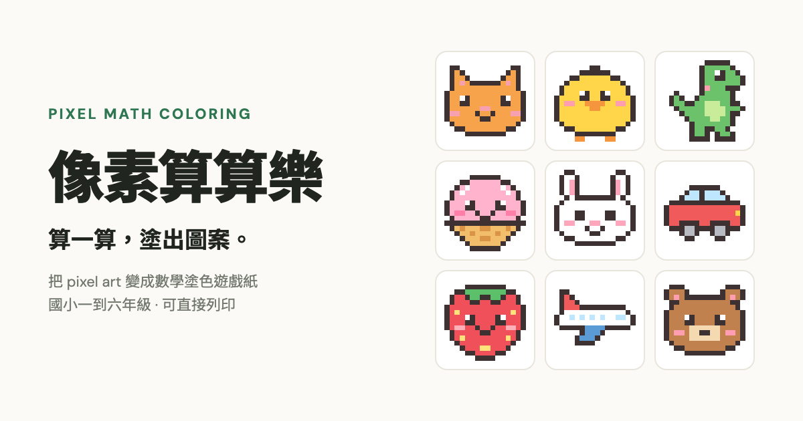

# 像素算算樂 Pixel Math Coloring

把 pixel art 變成數學塗色遊戲紙：每一格都是一道算式，算出答案、依色票塗色，就會出現隱藏圖案。適合國小一到六年級，可直接列印。

**線上使用：** https://yhlhenry.github.io/pixel-math-gallery/

## 怎麼用

1. 從「內建圖庫」挑一張圖（貓咪、恐龍、交通工具……），或上傳自己的 pixel art（PNG / JPG / WebP）。
2. 選擇配色方式（原圖代表色或電阻色碼）、年級難度和算式類型。
3. 按「生成算式塗色遊戲」。
4. 按「列印遊戲紙」發給學生，「列印答案」自己留著對答案。

列印時「邊界」選預設、「縮放」選 100%，作答格會撐滿整張 A4。

## 功能

- **一到六年級難度**：一、二年級是 10／20 以內加減；三年級加入乘除和兩位數；四年級練運算順序；五年級是較大的數字和兩步驟算式；六年級有括號。
- **算式寫在格子裡**：寬度 20 格以內的圖，算式直接印在格子中；更大的圖改用依列分區的座標題目表。
- **自動判斷像素格**：放大過的 pixel art（例如 37×40 的圖存成 12 倍大）會還原成原本的格數；一般大圖會依「最大格數」自動縮小。
- **題目編號**：每份遊戲紙都會印上題目編號。同一張圖、同樣的設定，輸入同一個編號就能重出一模一樣的題目。
- **隱私**：圖片只在瀏覽器裡處理，不會上傳到任何伺服器。

## 技術說明

整個工具只有一個 `index.html`，沒有建置步驟，也沒有相依套件（只從 Google Fonts 載入字型）。直接用瀏覽器開啟就能使用。

需要支援 CSS container queries 的瀏覽器：Chrome / Edge 105+、Safari 16+、Firefox 110+。

### 部署到 GitHub Pages

1. 把這個資料夾 push 到 GitHub repo。
2. 到 repo 的 **Settings → Pages**，Source 選 **Deploy from a branch**，Branch 選 `main`、資料夾選 `/ (root)`。
3. 幾分鐘後就能在 `https://<帳號>.github.io/<repo 名稱>/` 使用。

如果帳號或 repo 名稱不是 `yhlhenry/pixel-math-gallery`，記得修改 `index.html` 裡 `og:url`、`og:image` 的網址，以及本檔案最上面的連結。

## 致謝與授權

- 原始版本作者：（待補）
- 內建圖庫的 pixel art 為本專案原創。
- 授權：（待補，建議與原作者確認後再選定，例如 MIT）
